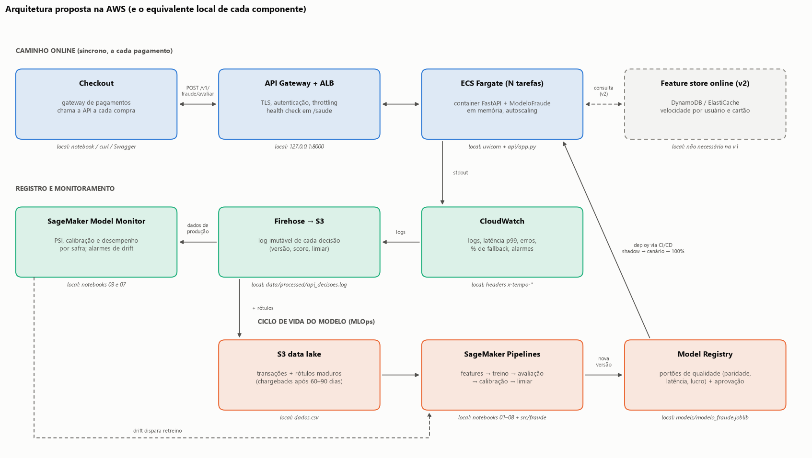

# Respostas: novo modelo de prevenção a fraudes

Este documento responde às oito perguntas do case e indica, em cada resposta, o notebook com a evidência correspondente (os números são reproduzíveis, conforme o [README](README.md)).

---

## 1. Modelo para prever fraude: técnicas testadas e abordagem escolhida

O desenvolvimento seguiu o CRISP-DM em nove notebooks, sempre com validação fora do tempo: treino de 08/03 a 31/03, validação de 01/04 a 10/04 e teste de 11/04 a 21/04, reservado até o fim, além de uma validação cruzada temporal com três folds semanais para comparar alternativas ([nb 01](notebooks/01_entendimento_dados.ipynb)). Na preparação ([nb 03](notebooks/03_eda.ipynb) e [nb 04](notebooks/04_feature_engineering.ipynb)), preservei os nulos, que se mostraram informativos. Também criei variáveis de horário (a fraude é 2,2 vezes maior entre 0h e 5h), uma codificação *out-of-fold* da categoria do produto e um score de risco do título (TF-IDF com regressão logística), e excluí `k`, que é ruído. Juntas, as novas features somam 0,022 de PR AUC, com ganho em todos os folds.

Entre os cinco algoritmos testados ([nb 05](notebooks/05_selecao_algoritmos.ipynb)), os três *gradient boostings* empataram no topo (PR AUC de ~0,418), enquanto a Random Forest (0,397) e a regressão logística (0,376) ficaram abaixo. Pesos de classe não melhoraram a ordenação e ainda distorceram as probabilidades, por isso a assimetria de custos foi tratada no ponto de corte. Escolhi, portanto, o LightGBM ([nb 06](notebooks/06_modelo_final.ipynb)), que desempata pelo lado operacional (treino rápido, nulos nativos, artefato pequeno). Ele foi ajustado com Optuna (PR AUC de 0,421) e calibrado pelo método de Platt, que preserva a ordenação e permite decidir por custo esperado. Por fim, o SHAP mostrou fatores dominantes plausíveis, sem sinais de vazamento.

---

## 2. Comparação com o modelo anterior (coluna `score`)

A comparação foi feita no período de teste, que nenhum dos modelos usou para treino ou ajuste ([nb 07](notebooks/07_avaliacao_oot.ipynb) e [nb 08](notebooks/08_decisao_negocio.ipynb)). Como a fraude é rara, adotei o PR AUC como métrica principal. Complementei com o ROC AUC e o KS, para a ordenação geral, com o *recall* a uma taxa fixa de bons clientes bloqueados e com o lucro, já que a perda é proporcional ao valor. O novo modelo vence em todas: o ROC AUC sobe de 0,726 para 0,851, o PR AUC de 0,227 para 0,368 (+62%) e o KS de 0,453 para 0,546. Além disso, o intervalo de 95% do ganho fica acima de zero, e o novo modelo vence em todos os 11 dias do teste.

O ganho se concentra onde o score atual falha, sobretudo na faixa de score de 0 a 25. Essa faixa reúne ~21% das fraudes, e nela o score atual é praticamente aleatório ([nb 02](notebooks/02_baseline_score_atual.ipynb)). Ali, o novo modelo captura ~27% dessas fraudes. Em dinheiro, com os cortes escolhidos no passado, o lucro no teste passa de R$ 79,1 mil para R$ 95,8 mil (+21%), e o novo modelo ainda aprova mais pagamentos e barra mais valor fraudado. Por isso, recomendo substituir o score atual, passando antes por *shadow mode* (modelo novo roda junto com o atual, recebendo os mesmos dados, mas sem afetar produção) e *rollout* gradual (resposta 8).

---

## 3. Como garantir que o desempenho no laboratório seja um proxy do desempenho em produção?

No laboratório, a garantia veio de desenhar o experimento como a produção funciona. Isso significou validação fora do tempo, com o teste intocado ([nb 01](notebooks/01_entendimento_dados.ipynb) e [nb 05](notebooks/05_selecao_algoritmos.ipynb)), e features dependentes do rótulo geradas *out-of-fold* ([nb 04](notebooks/04_feature_engineering.ipynb)). Também significou usar apenas informações disponíveis no momento da decisão, escolher o corte no passado ([nb 08](notebooks/08_decisao_negocio.ipynb)) e empacotar tudo num artefato único, cuja paridade entre o laboratório e a API foi testada ([nb 06](notebooks/06_modelo_final.ipynb) e [nb 09](notebooks/09_api_producao.ipynb)). Prova disso é que o ROC AUC estimado na validação cruzada (0,855) praticamente se repetiu no teste (0,851).

Ainda assim, alguns riscos só aparecem na implantação. A amostra pode não refletir a prevalência real, as transações bloqueadas pelo modelo atual nunca geram rótulo (o que pede um grupo de controle) e as contestações levam semanas para maturar. Por isso, o modelo deve rodar antes em *shadow mode*, pontuando o tráfego sem decidir, e só depois entrar num *rollout* gradual, sempre monitorado (resposta 8).

---

## 4. Se o desempenho produtivo for muito diferente do esperado, quais as causas mais prováveis?

Primeiro, é preciso distinguir se o modelo passou a ordenar pior ou se ordena bem com a política desajustada, já que os paliativos são diferentes: retreino num caso, recalibração ou novo corte no outro. A causa mais provável é a divergência entre o cálculo das features no treino e na API. Nesta base, por exemplo, `o` nulo é o estado de menor risco, então, se a API enviar uma string vazia no lugar de nulo, transações seguras passam a parecer arriscadas. Em seguida, vem a mudança na taxa de fraude, que desloca as probabilidades e o efeito do corte, como já ocorreu no teste ([nb 07](notebooks/07_avaliacao_oot.ipynb)).

Além disso, o *drift* de conceito é esperado, porque os fraudadores mudam de tática quando são bloqueados. Também contribuem rótulos ainda imaturos, uma amostra de desenvolvimento pouco representativa e a retroalimentação criada pelo próprio modelo. Somam-se mudanças de contexto, já que a base cobre o início da pandemia ([nb 01](notebooks/01_entendimento_dados.ipynb)), e falhas operacionais, como *timeouts* que acionam o *fallback* ou versões trocadas do artefato.

---

## 5. Com a informação de que uma fraude custa 10x mais que um bloqueio incorreto, o que faria de diferente?

Mudaria o limiar de decisão ([nb 08, Parte 3](notebooks/08_decisao_negocio.ipynb)). Como aprovar custa em média 10 × *p* e rejeitar custa 1 × (1 − *p*), vale rejeitar quando 10*p* > 1 − *p*. Isso equivale a rejeitar a partir de ~9% de probabilidade de fraude, e não dos 50% usados por padrão, e no teste essa troca reduziu o custo total em 22%. Em contrapartida, assume-se conscientemente o trade-off entre *recall* e precisão: o *recall* sobe de 20% para 65%, enquanto a precisão cai de 61% para 19%. Mesmo assim, compensa, já que, com custo de 10 para 1, qualquer precisão acima de ~9% "paga" o bloqueio.

---

## 6. Ponto de corte do score atual que maximiza o lucro (10% de ganho, 100% de perda)

O corte que maximiza o lucro é 76, ou seja, aprovar pagamentos com score até 75 e rejeitar a partir de 76 ([nb 08, Parte 1](notebooks/08_decisao_negocio.ipynb)). Para encontrá-lo, testei todos os cortes de 0 a 101 na base completa. Em cada um, somei 10% do valor das transações legítimas aprovadas e descontei o valor integral das fraudes aprovadas. Com o corte 76, o lucro sobe de R$ 50,8 mil (aprovando tudo) para R$ 264,9 mil, 5,2 vezes mais. O ponto segue a mesma regra de 1/11 da pergunta 5, aplicada ao valor: acima de 76, mais de 9,1% do dinheiro transacionado é fraude.

Além disso, o resultado é robusto: qualquer corte entre 74 e 80 entrega ao menos 99% do lucro máximo, e o ótimo fica entre 73 e 77 em todos os períodos. Ainda assim, o corte deve ser revisado periodicamente. Ele também não resolve a faixa de score 0 a 25, onde ~21% das fraudes passam sempre, limitação que só um modelo melhor superaria.

---

## 7. Se o modelo precisar responder online, no menor tempo possível, o que mudaria nas decisões do item 1?

O requisito de latência muda o desenho da solução, mas não a escolha do algoritmo ([nb 09](notebooks/09_api_producao.ipynb)). Na API local, o modelo leva ~1 ms por transação e a chamada HTTP completa, com validação e serialização, ~2–3 ms, bem abaixo dos orçamentos típicos de antifraude. Pedir os motivos do risco acrescenta ~1–2 ms, por isso essa explicação é opcional. Além disso, um único processo atende algumas centenas de requisições por segundo, de modo que o serviço escala horizontalmente, com mais processos e containers.

Portanto, as mudanças em relação ao item 1 estão no entorno do modelo. As features ficam restritas ao que existe no momento da decisão, e agregações históricas iriam para um *feature store* pré-computado. A inferência segue um caminho sem pandas, validado por teste de paridade. A latência passa a ser critério de seleção, como no desempate a favor do LightGBM ([nb 05](notebooks/05_selecao_algoritmos.ipynb)). Por fim, entram otimizações como modelo pré-carregado e *timeout* com *fallback*.

---

## 8. Como colocar esse modelo em produção?

Em AWS, o modelo poderia ser exposto como um serviço síncrono em FastAPI, como a API que já roda localmente ([nb 09](notebooks/09_api_producao.ipynb)), em ECS Fargate ou EKS (ou num *endpoint* do SageMaker) atrás de um API Gateway. O serviço carrega o artefato em memória e responde com probabilidade, decisão, motivos (SHAP) e versão. Para proteção do checkout, teria *timeout* com *fallback*, *autoscaling* e múltiplas zonas de disponibilidade. Já as futuras variáveis históricas por usuário ou cartão seriam agregadas em *streaming* (Kinesis e Flink) e lidas de um *feature store* online, como DynamoDB.

O ciclo de vida seria automatizado com SageMaker Pipelines, reutilizando o código de `src/fraude` sobre dados e rótulos maduros no S3. Antes de subir para o SageMaker Model Registry, o modelo passa por guardrails (desempenho, paridade e latência), e a implantação começa em *shadow mode*, seguida de um *rollout* gradual. Em produção, cada decisão seria registrada no S3 para auditoria e retreino. O monitoramento acompanharia latência, qualidade dos dados, *drift*, taxa de aprovação, calibração e desempenho por safra madura. Esses sinais poderiam disparar recalibrações mensais e retreinos periódicos ou emergenciais.

