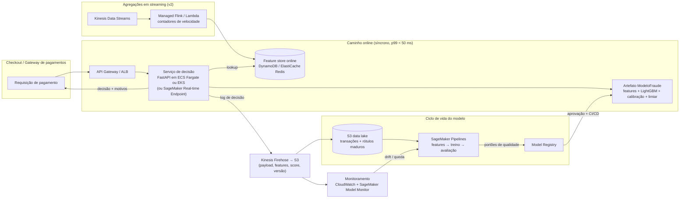

# Respostas: novo modelo de prevenção a fraudes (FREEDOM)

> Este documento responde às 8 perguntas do case. Cada resposta aponta para o notebook com a
> evidência. Todos os números vêm de execuções reproduzíveis
> (ver [README](README.md)).

**Resumo executivo**

- **Modelo proposto:** LightGBM com 25 features (variáveis da transação, horário, risco da categoria e
  risco textual do título do produto), tunado com validação cruzada temporal e calibrado.
- **No teste fora do tempo (11/04–21/04, nunca visto):** ROC AUC **0,851 vs 0,726** do score atual e
  PR AUC **0,368 vs 0,227** (+62%). O ganho é estatisticamente robusto e se repete em todos os dias.
- **Em dinheiro:** com o corte escolhido no passado e aplicado no teste, o novo modelo gera **+21% de
  lucro** que o score atual (+R$ 16,7 mil em 11 dias de amostra). Ele aprova mais clientes bons e
  bloqueia mais valor fraudado.
- **Ponto de corte do score atual (pergunta 6):** aprovar **score ≤ 75**, rejeitar **≥ 76**. O lucro
  passa de R$ 51 mil (aprovar tudo) para R$ 265 mil na base (5,2x).
- **Pronto para online:** ~0,8 ms por requisição, com paridade testada entre treino e serviço.

---

## 1. Modelo para prever fraude: técnicas testadas e abordagem escolhida

O desenvolvimento seguiu o CRISP-DM em 9 notebooks. As decisões foram tomadas sempre com **validação
fora do tempo**: treino até 31/03, validação 01–10/04, teste 11–21/04, e CV temporal em janela
expansiva (3 folds semanais) para comparar alternativas.

### 1.1 Preparação e features ([nb 03](notebooks/03_eda.ipynb), [nb 04](notebooks/04_feature_engineering.ipynb))

| Técnica / decisão | Por quê |
|---|---|
| Nulos **preservados** (árvores) ou com **indicador de ausência** (modelos lineares), sem imputação cega | A ausência é informativa: `o` nulo tem 1/10 do risco de `o = N`; `b/c` e `d/m` nulos têm mais risco |
| `o` em 3 estados, `p` binária, países relevantes como dummies | Riscos muito distintos entre níveis (`o = N`: 4,4x a média) |
| `hora`, `madrugada`, `dia_semana` | Fraude ~2,2x maior entre 0h e 5h |
| **Target encoding suavizado out-of-fold** da categoria `j` | 8,3 mil categorias, risco de ~1% a ~27%, cauda longa |
| **Score textual do título** (TF-IDF + regressão logística, out-of-fold) | Celulares, gift cards e itens de revenda concentram fraude |
| Exclusão de `k` | Um valor por linha, distribuição uniforme, AUC 0,50: ruído (confirmado na ablação) |
| Features de velocidade testadas e **descartadas** | Ganho instável e escala dependente da amostragem (risco de skew em produção) |

O **teste de ablação** pareado mostrou ganhos consistentes de tempo (+0,012 PR AUC, 3/3 folds) e
categoria (+0,007, 3/3), ganho menor do texto (+0,003) e nenhum ganho de `k`.

### 1.2 Algoritmos testados ([nb 05](notebooks/05_selecao_algoritmos.ipynb))

| Algoritmo | PR AUC (CV) | ROC AUC (CV) | Observação |
|---|---|---|---|
| Regressão logística (log + imputação + escala) | 0,376 | 0,849 | erra no topo do ranking, onde se bloqueia |
| Random Forest | 0,398 | 0,845 | um degrau abaixo; pesada |
| XGBoost | 0,418 | 0,853 | empate técnico no topo |
| **LightGBM** | **0,418** | **0,853** | empate técnico no topo; treino mais rápido |
| CatBoost | 0,416 | 0,854 | empate técnico no topo; treino ~7x mais lento |

Também testei **tratamento de desbalanceamento** (`scale_pos_weight`, `class_weight`). Os pesos **não
melhoraram a ordenação** e distorceram as probabilidades (média prevista de 26% para 5,7% de fraude
real). A assimetria de custo é tratada no ponto de corte.

### 1.3 Abordagem escolhida ([nb 06](notebooks/06_modelo_final.ipynb))

**LightGBM tunado + calibração de Platt**, empacotado com o construtor de features num único artefato.

- **Por que LightGBM:** está no grupo de melhor desempenho (as diferenças entre os boostings são menores
  que a variação entre folds, ou seja, o limite está nas features). O desempate foi operacional: treino
  mais rápido (tuning e retreinos frequentes), nulos nativos, artefato pequeno e ferramental maduro
  (SHAP, ONNX).
- **Tuning:** Optuna (TPE, 40 tentativas), maximizando o PR AUC **médio** dos folds temporais, com
  `n_estimators` tunado diretamente (sem early stopping na janela avaliada). Resultado: PR AUC 0,418 →
  **0,421**, melhorando nos 3 folds. Configuração final: 650 árvores, 16 folhas, `learning_rate` 0,0225
  e regularização L2 forte.
- **Calibração:** comparei isotônica e Platt fora da amostra. O **Platt** preservou a ordenação (a
  isotônica perdeu 0,015 de PR AUC com os empates) e teve o melhor Brier. A probabilidade calibrada é o
  que permite decidir por custo esperado (perguntas 5 e 6).
- **Explicabilidade (SHAP):** os fatores dominantes são plausíveis e coerentes com a EDA: `o`, histórico
  baixo (`l`, `m`, `f`), valor, produto (título/categoria), madrugada. Não há sinais de vazamento. O SHAP
  também dá **motivos por transação** para a revisão manual.
- **Métrica principal: PR AUC.** Ela foca na classe rara e no topo do ranking. ROC AUC, KS e Recall @
  FPR completam a leitura, e o **lucro** é a métrica de decisão.

---

## 2. Comparação com o modelo anterior (coluna `score`)

A comparação foi feita no **período de teste fora do tempo** (11/04–21/04, 41,5 mil transações, 4,5% de
fraude), que nenhum dos dois modelos usou para treino ou escolha de parâmetros
([nb 07](notebooks/07_avaliacao_oot.ipynb), [nb 08](notebooks/08_decisao_negocio.ipynb)).

### Métricas usadas e por quê
- **ROC AUC e KS:** capacidade geral de ordenar o risco, comparáveis com o mercado.
- **PR AUC (average precision):** métrica principal. Com 5% de fraude, foca no que importa: a precisão
  no topo do ranking, onde se bloqueia.
- **Recall @ FPR x%:** fraude capturada aceitando bloquear x% dos clientes bons, a linguagem do negócio.
- **Captura em R$ e lucro:** a perda é proporcional ao valor, então um modelo que pega as fraudes caras
  vale mais.
- **Robustez:** IC bootstrap pareado do ganho e desempenho dia a dia.

### Resultados

| Métrica (teste OOT) | Score atual | Novo modelo | Ganho |
|---|---|---|---|
| ROC AUC | 0,726 | **0,851** | +17% |
| PR AUC | 0,227 | **0,368** | +62% |
| KS | 0,453 | **0,546** | +20% |
| Recall @ FPR 1% | 15,8% | **25,2%** | +60% |
| Recall @ FPR 5% | 41,8% | **47,8%** | +14% |
| Recall em R$ @ FPR 5% | 44,1% | **62,6%** | +42% |
| **Lucro no teste** (corte escolhido no passado) | R$ 79,1 mil | **R$ 95,8 mil** | **+21%** |

- **Significância:** IC 95% do ganho de ROC AUC [+0,109; +0,140] e de PR AUC [+0,118; +0,163]. Em
  nenhuma das 500 reamostragens o score atual empatou ou venceu.
- **Consistência:** o novo modelo vence **em todos os 11 dias** do teste (ROC AUC diário 0,82–0,87
  contra 0,63–0,77), inclusive no dia atípico de 15/04.
- **Onde está o ganho:**
  - **Zona cega do score atual:** ~21–24% das fraudes recebem score 0–25, onde o score atual é
    praticamente aleatório (AUC 0,54 dentro da faixa). Essas fraudes passam por qualquer corte. Com a
    mesma taxa de bloqueio (10%), o novo modelo captura ~27% delas e metade das fraudes da faixa 61–80.
  - **Topo do ranking:** bloqueando só 1% das transações, a precisão sobe de 46% para 70%.
  - **Fraudes caras:** o ganho em R$ (+42% no recall em valor) supera o ganho em quantidade.
- **Política:** com o corte escolhido no passado, o novo modelo **aprova mais** (83,9% vs 81,2%),
  **bloqueia menos clientes bons** (13,7% vs 16,8%) e **barra mais valor fraudado** (78,5% vs 65,7%).

**Conclusão:** o novo modelo é superior de forma estatisticamente robusta, estável no tempo e
traduzida em lucro, e é recomendado para substituir o score atual (via shadow mode e rollout gradual,
resposta 8). Um ponto de atenção: combinar os dois modelos (*stacking*) ainda melhora o topo do ranking
(PR AUC 0,394). O score antigo carrega informação complementar, que vale investigar e trazer como
features próprias na v2, sem criar dependência do modelo que será aposentado.

---

## 3. Como garantir que o desempenho no laboratório seja um proxy do desempenho em produção?

A garantia vem de **desenhar o experimento como a produção funciona** e de **verificar em produção
antes de confiar**. O que foi feito neste projeto e o que faria na implantação:

**No laboratório (feito neste projeto)**

| Risco | Prática adotada | Onde |
|---|---|---|
| Avaliar com dados "do futuro" ou misturados no tempo | **Validação out-of-time**: treino até 10/04, teste 11/04–21/04 intocado até o fim; seleção de modelos com **CV temporal em janela expansiva** | nb 01, 05, 06 |
| Vazamento do alvo em features | Target encoding e score de texto gerados **out-of-fold**. Demonstramos que a versão ingênua infla o AUC do texto de 0,65 para 0,86 no treino | nb 04 |
| Features indisponíveis na hora da decisão | Só payload + tabelas versionadas com o modelo. Features de velocidade calculadas sobre uma *amostra* foram **descartadas** por terem outra escala em produção | nb 04, 09 |
| Decisões tomadas olhando o teste | Corte do novo modelo **escolhido no período dev** e só aplicado no teste | nb 08 |
| Implementação diferente entre treino e API (*training-serving skew*) | Um único artefato (`ModeloFraude`) com features + modelo + calibração. **Teste de paridade** lote × online com 100% de decisões idênticas | nb 06, 09 |
| Resultado frágil ou fruto de sorte | IC bootstrap do ganho, estabilidade diária e por fold, robustez do corte | nb 07, 08 |

**Evidência de que funcionou:** o ROC AUC estimado na CV temporal (0,855) foi praticamente o mesmo
observado no teste fora do tempo (0,851).

**Na implantação (o que ainda falta garantir)**

1. **Representatividade da amostra.** A base é uma amostra com 5% de fraude. Precisamos confirmar com
   Analytics o desenho amostral (taxa de fraude real, estratificações, filtros). Probabilidades,
   cortes e lucro dependem da **prevalência real** e, se a amostra foi enriquecida em fraude, precisam
   ser recalibrados.
2. **Viés de seleção (rótulos censurados).** Transações bloqueadas pelo modelo atual **não geram
   chargeback**, então nunca saberemos se eram fraude. O modelo aprende só com o que foi aprovado.
   Mitigações: um pequeno **grupo de controle** aprovado aleatoriamente (ou com regras mais brandas)
   para obter rótulos não enviesados, e técnicas de *reject inference*.
3. **Maturação do rótulo.** Chargebacks chegam semanas depois. Avaliar o modelo com safras imaturas
   subestima a fraude. Usar **safras maduras** (ex.: 60–90 dias) nas avaliações e retreinos, e uma
   janela de *gap* entre treino e validação.
4. **Shadow mode antes de decidir.** O novo modelo pontua 100% do tráfego real **sem decidir** por 2–4
   semanas. Comparamos distribuição de score, taxa de rejeição simulada e latência com o laboratório
   e, conforme os rótulos maturam, as métricas.
5. **Champion/challenger com rollout gradual** (ex.: 5% → 25% → 100% do tráfego), com o modelo atual
   como controle e critérios de parada definidos antes.
6. **Monitoramento contínuo** de PSI de features e score, taxa de aprovação, calibração e desempenho
   por safra madura (resposta 8).

---

## 4. Se o desempenho produtivo for muito diferente do esperado, quais as causas mais prováveis?

Em ordem de probabilidade, com um sinal típico e como diagnosticar:

| # | Causa | Sinal típico | Como diagnosticar |
|---|---|---|---|
| 1 | **Training-serving skew**: features calculadas diferente na API (nulos, tipos, encoding, fuso horário, normalização de texto) | Distribuição do score em produção ≠ laboratório **desde o dia 1** | Reprocessar payloads reais pelo pipeline de treino e comparar feature a feature. **Exemplo crítico desta base:** `o` nulo é o estado de **menor** risco. Se a API enviar `""` ou `"null"` em vez de nulo, milhares de transações seguras viram "risco alto" |
| 2 | **Mudança na taxa de fraude (prior shift)** quebrando a calibração e o corte | Ordenação (AUC) ok, mas taxa de rejeição e lucro fora do esperado | Comparar prob. média prevista × taxa real por safra. **Já observado neste projeto:** no teste a fraude caiu para 4,5% e o modelo passou a superestimar o risco (nb 07) |
| 3 | **Drift de conceito (fraude adversarial):** fraudadores mudam de tática ao serem bloqueados (novos produtos, horários, contas "envelhecidas") | Queda gradual do recall em safras recentes. Novas categorias ou palavras de risco | PSI das features, desempenho por segmento ao longo do tempo, análise das fraudes não capturadas |
| 4 | **Rótulos imaturos ou diferentes** (definição de fraude, prazo de chargeback, fraude amigável) | Desempenho "piora" nas safras recentes e "melhora" depois | Recalcular as métricas por safra conforme os rótulos maturam |
| 5 | **Amostra de desenvolvimento não representativa** (amostragem, viés de seleção pelos bloqueios do modelo atual) | Diferença estável e grande desde o início | Comparar mix de países, categorias e valores entre a amostra e o tráfego real |
| 6 | **Feedback loop:** o novo modelo muda o que é aprovado e, portanto, os dados futuros de treino | Métricas que se degradam a cada retreino | Grupo de controle aleatório; avaliar sempre contra ele |
| 7 | **Mudança de contexto/sazonalidade:** a base cobre o início da pandemia (mar–abr/2020), com volume 35% menor e fraude 35% maior por uma semana | Ruptura em datas específicas, campanhas, Black Friday | Segmentar por período; não extrapolar um regime atípico |
| 8 | **Problemas operacionais:** timeouts acionando *fallback*, versões de artefato trocadas, categorias novas caindo no valor padrão | Picos de latência, decisões "default", versão errada nos logs | Logs de decisão com versão do modelo e flags de fallback |

A primeira ação é sempre **separar "o modelo ordena pior" (AUC/PR AUC por safra madura) de "o modelo
ordena bem, mas a política está errada"** (calibração/corte). Os remédios são diferentes: retreino ou
features novas no primeiro caso, recalibração ou novo corte no segundo.

---

## 5. Com a informação de que uma fraude custa 10x mais que um bloqueio incorreto, o que faria de diferente?

Evidência em [nb 08, Parte C](notebooks/08_decisao_negocio.ipynb). O modelo em si (a ordenação) não
precisa mudar. O que muda é **como transformamos probabilidade em decisão** e **como avaliamos**.

1. **Mover o limiar de decisão para 1/11, e não 0,5.** Minimizar o custo esperado leva a rejeitar
   quando $p \cdot 10 > (1-p) \cdot 1$, ou seja, $p > 1/11 \approx 0{,}091$. Por isso calibrar as
   probabilidades era pré-requisito. No teste, trocar 0,5 por 1/11 **reduziu o custo total em 22%**
   (de ~15,0 mil para ~11,7 mil unidades). As fraudes aprovadas caíram de 1.480 para 647, ao preço de
   mais bloqueios indevidos (236 → 5.210), troca que compensa quando a fraude custa 10x. O limiar de
   mínimo custo estimado no passado (0,105) ficou perto do teórico.
2. **Trocar a métrica de avaliação e de tuning:** custo esperado (ou lucro) em vez de
   acurácia/F1. Na seleção de modelos, priorizar PR AUC e recall na região de limiar baixo.
3. **Preferir calibração + limiar a reponderar o treino.** Testei treinar com peso 10 nas fraudes e usar
   limiar 0,5. Como prevê a teoria, o custo ficou próximo (~1,5% de diferença), mas a ordenação piorou um
   pouco. Com uma probabilidade calibrada, **qualquer** mudança de custo (10x → 8x) vira só uma troca de
   limiar, sem retreino.
4. **Criar uma terceira via para a zona cinzenta.** Com FN tão caro, transações de risco intermediário
   (ex.: 5% < p < 20%) devem ir para **autenticação adicional** (3DS, biometria, token) ou **revisão
   manual**, e não para bloqueio seco. Isso reduz o custo dos FPs, que nessa política se multiplicam.
5. **Segmentar a política:** limiares diferentes por segmento (categoria de alto risco, usuário novo,
   faixa de valor) quando os custos ou a calibração variam entre eles.
6. **Questionar o "1x" do falso positivo:** o custo de bloquear um bom cliente inclui abandono e perda
   de vida útil (LTV). Vale medir com experimento e revisar a razão de custos com o negócio.

Observação: a pergunta 6 leva **ao mesmo limiar 1/11**, porque lá a razão perda/margem também é 10
(100% vs 10%). A diferença é que lá o custo é proporcional ao valor, o que torna o ranking por valor
(fraudes caras primeiro) ainda mais importante.

---

## 6. Ponto de corte do score atual que maximiza o lucro (10% de ganho, 100% de perda)

Evidência em [nb 08, Parte A](notebooks/08_decisao_negocio.ipynb).

**Resposta: corte = 76. Aprovar pagamentos com score ≤ 75 e rejeitar os com score ≥ 76.**

**Método.** Para cada corte possível $c \in \{0, \dots, 101\}$, aprova-se score < c e calcula-se:

$$\text{Lucro}(c) = \sum_{\text{aprovadas legítimas}} 0{,}10 \cdot \text{monto} \;-\; \sum_{\text{aprovadas fraudes}} 1{,}00 \cdot \text{monto}$$

O corte que maximiza o lucro foi escolhido por busca exaustiva na base completa (150 mil transações).
Como o score atual não foi treinado neste projeto, não há risco de vazamento em usá-la inteira.

| Política | Lucro | Aprovação | Fraudes bloqueadas | Valor fraudado bloqueado | Legítimas bloqueadas |
|---|---|---|---|---|---|
| Aprovar tudo | R$ 50.849 | 100% | 0% | 0% | 0% |
| **Corte 76** | **R$ 264.929 (5,2x)** | 77,6% | 63,0% | 69,2% | 20,3% |

**Por que 76? A regra de 1/11.** Aprovar vale a pena enquanto $0{,}10(1-p) > p$, isto é, $p < 1/11 \approx 9{,}1\%$.
Como o score atual não é uma probabilidade (é um percentil), a regra equivalente é: rejeitar os scores
em que **a fração do valor transacionado que é fraude** passa de 9,1%. Essa curva cruza 9,1%
justamente em ~76. Como as fraudes têm ticket maior, o corte ótimo fica abaixo do ponto em que a taxa
de fraude **em quantidade** chega a 9,1% (~85). Otimizar por quantidade deixaria passar fraudes caras.

**Robustez.**
- O topo da curva é **achatado**: cortes de 73 a 80 entregam ≥ 99% do lucro máximo.
- **Bootstrap** (500 reamostragens): IC 90% do corte ótimo [73, 81], moda 76.
- **Por período:** ótimo de 76 no treino, 73 na validação e 77 no teste. Usar 76 em todos captura de
  96,5% a 100% do lucro máximo de cada período.

**Ressalvas.** (i) O corte deve ser revisado periodicamente, porque a taxa de fraude e o próprio score
mudaram no período (degrau no score médio em 30/03). (ii) Nenhum corte resolve a **zona cega** (score
0–25), onde ~21% das fraudes são sempre aprovadas. Só um modelo melhor resolve isso, e o novo modelo,
com o seu limiar ótimo (p ≥ 0,088 ≈ 1/11), gerou +21% de lucro sobre o score atual no teste.

---

## 7. Se o modelo precisar responder online, no menor tempo possível, o que mudaria nas decisões do item 1?

Evidência em [nb 09](notebooks/09_latencia_producao.ipynb) e [nb 05](notebooks/05_selecao_algoritmos.ipynb).

**Neste caso, o requisito de latência muda o desenho da solução, mas não a escolha do algoritmo.**
Medi a latência por requisição (uma transação JSON, CPU comum, Python):

| Variante | PR AUC (teste) | Latência p50 | Comentário |
|---|---|---|---|
| **LightGBM completo, com texto (escolhido)** | **0,368** | ~0,6 ms (modelo + features) / ~0,8 ms com calibração | o TF-IDF do título é ~60% do tempo; as 650 árvores levam só ~0,1 ms |
| LightGBM sem texto | 0,362 | ~0,12 ms | 5x mais rápido por −1,5% de PR AUC: primeira alavanca se apertar |
| LightGBM compacto (150 árvores) | 0,360 | ~0,07 ms | segunda alavanca |
| Regressão logística | 0,315 | ~0,5 ms | perde 14% e nem é mais rápida (overhead do pipeline) |
| *Mesmo modelo via pandas, 1 linha* | 0,368 | *~25 ms* | *como **não** servir: 30x mais lento* |

Todas as variantes ficam abaixo de 1 ms, muito abaixo de orçamentos típicos de antifraude (dezenas de
ms para o motor inteiro). **Não há motivo para sacrificar desempenho.** O que muda nas decisões do item 1:

1. **Features só do que existe no momento da decisão.** Todas as 25 features vêm do payload ou de tabelas
   em memória versionadas com o modelo (risco da categoria, modelo de texto). Nenhuma exige consulta
   externa síncrona. Agregações históricas (velocidade por usuário/cartão/dispositivo) iriam para um
   **feature store online pré-computado** via streaming, e não calculadas na requisição.
2. **Caminho de inferência dedicado**, sem pandas, montando o vetor de features direto do JSON. Como
   ele reimplementa a lógica de treino, entra o **teste de paridade** obrigatório no CI: diferença
   máxima de 5e-7 e 100% das decisões idênticas.
3. **Orçamento de latência por etapa** e variantes prontas (sem texto, compacto), com o custo em
   desempenho de cada uma já medido. Na seleção de algoritmos, a latência e o tempo de treino entraram
   como critério de desempate: entre boostings empatados, o LightGBM.
4. **Otimizações de engenharia em escala:** calibração como fórmula fechada (a do scikit-learn é ~0,1 ms
   de overhead), compilação do modelo (ONNX Runtime / Treelite), serviço com o modelo pré-carregado e
   processamento assíncrono, **timeout com fallback** (score atual ou regras) e logging assíncrono das
   decisões.
5. Se o orçamento fosse extremo (ex.: < 0,1 ms em hardware embarcado), eu aceitaria a variante sem
   texto/compacta e reavaliaria o lucro, já que a perda de PR AUC está quantificada.

---

## 8. Como colocar esse modelo em produção?

A proposta abaixo usa AWS. O objetivo é um serviço de decisão **síncrono, de baixa latência e
auditável**, com um ciclo de vida de modelo (treino → validação → implantação → monitoramento →
retreino) automatizado e com portões de qualidade.

### 8.1 Arquitetura



### 8.2 Camada de serviço (caminho online)

- **Contrato da API:** `POST /v1/fraude/avaliar` recebe o payload da transação e devolve
  `{probabilidade_fraude, decisao, motivos, versao_modelo}`. Os motivos são as top contribuições SHAP,
  úteis para a fila de revisão e para responder contestações.
- **Serviço:** container com FastAPI/uvicorn que carrega o artefato `ModeloFraude` (3 MB) **na
  inicialização**. A inferência roda em memória pelo caminho rápido sem pandas (`pontuar`), em
  **~1 ms** (nb 09). Opções: **ECS Fargate/EKS** (mais controle de latência e custo em alto volume) ou
  **SageMaker real-time endpoint** (menos operação). Autoscaling por RPS/latência, várias AZs.
- **Resiliência:** timeout rígido (ex.: 50 ms) com **fallback** definido pelo negócio (score atual,
  regras ou aprovação abaixo de um valor), circuit breaker e logs de toda decisão em fallback.
- **Esboço do serviço:**

```python
from fastapi import FastAPI
from fraude.inferencia import ModeloFraude

app = FastAPI()
modelo = ModeloFraude.carregar("models/modelo_fraude.joblib")  # carregado uma vez, em memória

@app.post("/v1/fraude/avaliar")
def avaliar(transacao: dict) -> dict:
    return modelo.pontuar(transacao)   # {probabilidade_fraude, decisao, versao_modelo}
```

### 8.3 Pipeline de treino e implantação (MLOps)

1. **Dados:** transações e rótulos no S3 (Glue/Athena), com rótulos considerados **maduros** só após
   a janela de chargeback.
2. **SageMaker Pipelines** (ou Airflow/Step Functions): o mesmo código deste repositório
   (`src/fraude`) em etapas de *processing* (features), *training* (LightGBM com os hiperparâmetros
   versionados), *evaluation* (CV temporal + OOT) e calibração/limiar.
3. **Portões de qualidade antes do registro:** PR AUC e lucro no OOT ≥ campeão atual; testes de
   paridade lote × online (nb 09); estabilidade (PSI); latência p99 dentro do orçamento; checagem de
   schema.
4. **Model Registry** com versão, métricas, dados de treino e *model card*. Aprovação humana para
   promoção.
5. **CI/CD** (CodePipeline/GitHub Actions): build da imagem, testes, deploy **em shadow** e depois
   **canário / champion-challenger** (resposta 3).

### 8.4 Monitoramento e retreino

| O que monitorar | Como | Ação |
|---|---|---|
| Saúde do serviço | latência p50/p99, erros, % de fallback (CloudWatch) | alarme on-call |
| Qualidade dos dados | schema, % de nulos por campo (ex.: `o`), categorias novas | alarme e bloqueio de deploy |
| Drift | PSI das features e do score, diário | investigar e, se persistir, retreinar |
| Política | taxa de aprovação/rejeição, valor rejeitado | revisar o limiar |
| Calibração | prob. média prevista × fraude observada por safra | **recalibrar** (barato, sem retreino) |
| Desempenho real | PR AUC / recall / lucro por **safra madura** + grupo de controle | retreinar / novas features |

**Cadência sugerida:** recalibração e revisão do limiar mensais (ou por alerta), retreino mensal ou
trimestral com janela móvel, e retreino emergencial quando o drift for confirmado.

### 8.5 Governança

Log imutável de cada decisão (payload, features, score, versão, limiar) para auditoria e para treinar
a próxima versão. Explicabilidade por transação (SHAP). Controle de acesso e minimização de dados
pessoais (LGPD). Documentação do modelo e da política aprovada pelo negócio.
